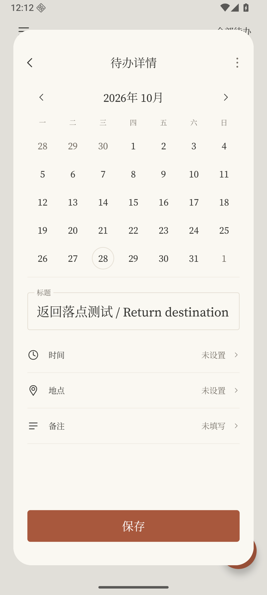
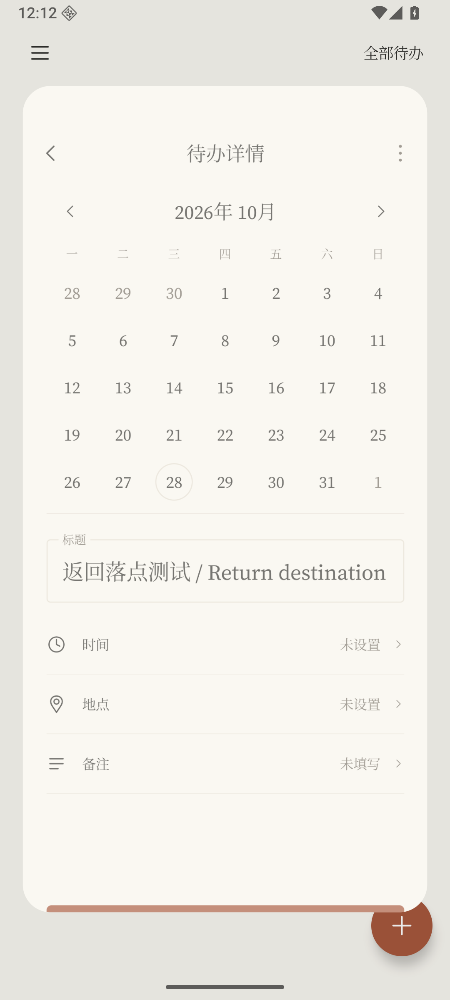
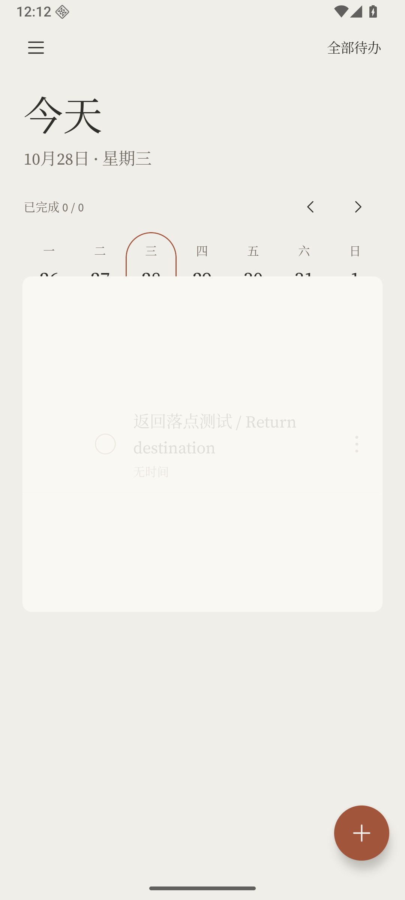

# 0.4.3：详情淡出并落回真实条目

按 2026-10-28 用户确认的方案改进 B 版：仅透明度渐显，不加模糊；未创建或没有可用的可见目标时回到中央。进入详情保留 0.4.1 的淡入平移。版本 **0.4.3 / code 8**，沿用 Debug／Release 各自的签名及 Room v1。

## 返回过程

1. 跟随系统边缘返回进度，等比缩小并增大圆角。小幅系统进度也能看到变化，逐渐接近 90% 的尺寸下限。取消手势时恢复原尺寸，保留草稿。
2. 确认返回时用最多 110ms 补足缩小阶段，手势已经缩到下限时直接接续收回；顶部返回、旧系统或 OEM 未提供连续进度时也执行此阶段，不再只缩小到 96.5%。
3. 在 340ms 的收回中，前 55% 让详情内容向下移动最多 32dp 并淡出。详情透明度降到零以后，才让条目画面由透明变清晰。容器上下边界沿平滑曲线靠近目标，文字不被纵向压扁。
4. 有目标时，动画最后一帧的位置、尺寸与真实条目一致，再显露可交互条目。没有创建、已删除、日期或搜索筛选导致目标不在当前完整可见范围时，收向屏幕中央；不自动滚动列表。

顶部返回默认居中缩小，左右边缘手势有相应方向的小幅跟随。键盘显示时先清焦点、收起键盘并等待 Insets 稳定，避免键盘和卡片同时变形。减少动态效果仍使用淡入淡出。

## 真实落点与内容交接

- 返回前捕获一次详情画面，立即恢复真实列表，由根级动画层接续画面，因此动画不会随详情导航项销毁而中断。
- 根据当前列表中的实际条目获取布局边界和画面；不再使用进入前的旧行位置或旧标题。新建保存后使用仓库返回的真实 ID，定位新条目。
- 暂时隐藏目标行的绘制，保留它的布局位置；用该行自身的画面渐显，最后切回真实行，避免两份文字重叠。动画期间停用列表插入／位移动效，并阻止重复返回和背后列表操作。
- 只在开始时读回详情和目标行图像，动画帧只做位移、等比缩放、圆角裁切和透明度变化，不逐帧重排整个编辑表单。
- 通知打开新详情时取消旧过渡；旧动画不能关闭新详情。图片捕获失败时退回普通返回，不阻止保存或退出。
- 新建窗口保留原有进入效果；保存和取消也使用上述返回交接。未保存内容不会写入数据库。

## 验证与边界

使用独立 API 36 x86_64 / SwiftShader 模拟器（ADB 15038），未连接用户手机。系统边缘测试通过 UiAutomation 将触摸输入发到 System UI，而不是只调用 Activity dispatcher；覆盖左侧拖动、回拉取消、右侧松手返回，并保留屏幕采样。导航模式测试后恢复原值。

- JVM：59 项通过，1 项真实模型评估按设计跳过；Lint 零错误。Debug、测试 APK、R8 benchmark、签名 Release 构建通过。
- API 36 全套：45 项通过，1 项手工提醒夹具跳过；包含实际 System UI 边缘手势。最后补足缩小时间的调整后，系统手势及返回回归 4/4 通过。
- 最终代码在 360dp / 130% 字体下，条目落点、新建／取消、不可见目标和长标题回归 5/5 通过。测试后恢复 420dpi、字体 100%、三键导航。

屏幕采样来自实际模拟器渲染。正常尺寸采样在最后的“按剩余进度补足缩小时间”调整之前；该调整不改变这些静态画面。

| 有限缩小 | 详情下移淡出 | 条目渐显并靠近落点 |
| --- | --- | --- |
|  |  |  |

[最终条目](ui-0.4.3/landed-on-row.png) · [真实系统边缘手势](ui-0.4.3/native-right-held.png) · [取消创建](ui-0.4.3/cancel-create-center.png) · [新建成功](ui-0.4.3/new-task-row-fading-in.png)

本版本仍不声称 OPPO 真机验收、60/120fps 或整体掉帧率门槛已通过。已明确暂缓的重启提醒问题未修改。

## 同环境帧测量

独立包 `com.example.todo.benchmark`，API 36 x86_64 / SwiftShader、420dpi / 100% 字体 / 三键导航，R8 + `CompilationMode.Full`，每版 10 轮、每轮 3 次进入和返回。顺序执行，测量时没有并行 Gradle 构建。0.4.3 测量包含最终的缩小剩余时长调整。

| 指标（ms） | 0.4.2-B | 0.4.3 |
| --- | ---: | ---: |
| CPU 帧耗时 P50 | 23.21 | 26.20 |
| CPU 帧耗时 P95 | 37.11 | 38.42 |
| 帧截止超时 P50 | 8.21 | 13.20 |
| 帧截止超时 P95 | 28.62 | 29.17 |

此次测量**没有显示整体帧耗时下降**；新增真实条目交接和较长收回过程也改变了采样帧的组成（1060 / 1438 帧）。单次模拟器样本不足以证明稳定的性能差异。本次改动修复流程、落点及缩小可见性，不把这些数值宣称为真机流畅度提升。

测量用按键 Back，不是连续系统手势；系统手势另外有功能测试。交付的 Debug APK 与 R8 / Full-AOT 性能包不等价，不能由此推断交付包 FPS，也不能将帧数换算为帧率。尚未生成实测 Baseline Profile。

[对比摘要与 APK SHA256](performance-0.4.3/comparison.json) · [旧版原始数据](performance-0.4.3/0.4.2-B-benchmarkData.json) · [新版原始数据](performance-0.4.3/0.4.3-benchmarkData.json) · [测试结果摘要](performance-0.4.3/verification.txt)。完整运行日志和 20 份 Perfetto trace 保存在本地忽略目录 `.tools/performance/ui043/`。
