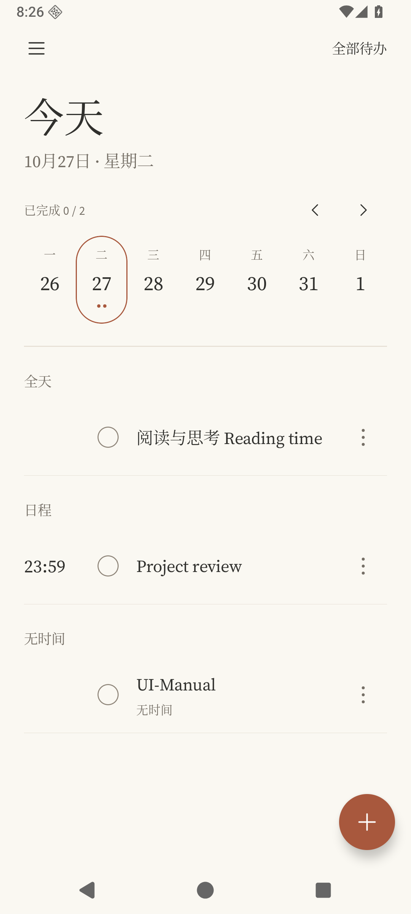
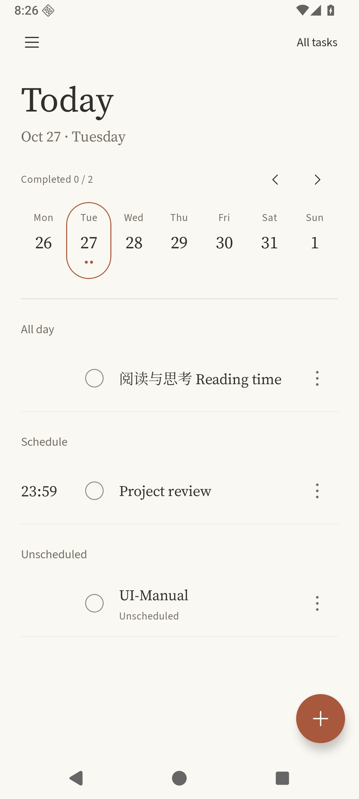

# 0.4.0 列表与个性化

版本 **0.4.0 / code 5**，沿用 Room v1、现有 Debug／Release 签名及思源宋体。适合已有测试安装覆盖更新的是 `dist/todo-0.4.0-debug.apk`。

| 用户要求 | 实现 |
| --- | --- |
| 全天与日程对齐、放大时间和菜单 | 所有事项预留同一时间列，全天前方留空。定时事项的 HH:mm 由 14sp 调为 18sp，右侧三个圆点由 18dp 调为 24dp，点击范围仍为 48dp；大字号下时间列同步加宽。 |
| 时间滚轮 | 小时 00–23、分钟 00–59，滚动吸附并循环选取，不弹出数字键盘。添加／详情、AI 预览、默认全天提醒时间共用；确认后应用，取消不修改。 |
| 英文支持 | 设置 → 应用语言：跟随系统／简体中文／English。覆盖页面、日历、设置、无障碍描述、错误提示与新发提醒的通知按钮。切换后恢复页面，重启保留选择。用户输入内容保持原文。 |
| 配色个性化 | 设置 → 主题配色：陶土、鼠尾草、海蓝、紫藤、玫瑰。自定义支持 `#RRGGBB` 和 RGB 滑块，深浅主题分别调整对比度。选择配色会关闭动态取色，仍可重新开启；默认陶土主题保留。 |

滑动一级菜单、撤销、日历选日、提醒与重复规则、现有动效和减少动态效果模式均保留。英文支持是应用界面本地化，未扩展中文本地规则解析器的语法；英文界面的该入口明确显示 `Use local rules (Chinese)`。

## 验证与边界

- JVM：54 项通过，1 项真实模型网络评测按设计跳过；新增极端自定义颜色对比度和无效颜色输入验证。
- Debug／测试包、签名 R8 Release、profile／benchmark 构建通过；Lint 零错误（25 warning、1 hint）。最终语言初始化调整后，4 项新界面测试再次通过。
- 268 条双语资源的覆盖与格式参数检查通过：`python3 scripts/check-localization.py`。
- API 36 独立模拟器完整 instrumentation：36 项通过，1 项手动场景准备工具按设计跳过。包含原有 CRUD、滑动菜单／撤销、添加返回、Room、提醒、Keystore、分享与假模型导入测试。
- 新增 4 项界面测试验证列坐标对齐、真实滚轮滑动／边界／取消／保存、语言切换与页面重建、英文通知操作及原文保留、自定义颜色校验／持久化／深色模式。
- 360dp 窄屏、130% 字号：上述 4 项与原有 3 项 UI 回归全部通过；截图检查英文滚轮、编辑页和颜色对话框。
- 首轮专项测试缺少异步详情加载等待；首轮完整回归有一次字段编辑点击早于键盘收起。补充相应等待条件后完整重跑通过，没有用关闭动效来规避测试。

本地日志：`.tools/0.4-final-build.log`、`.tools/0.4-full-suite-final.log`、`.tools/0.4-narrow-font130.log`、`.tools/0.4-locale-final-build.log`、`.tools/0.4-locale-final-check.log`。截图使用合成数据，日期按模拟器时区显示。旧版 Android 的语言兼容路径、厂商系统、真机手感与帧率尚未在本轮验证；OPPO 重启提醒失败仍按用户要求暂缓。

## 实际渲染

| 中文对齐首页 | 英文首页 |
| --- | --- |
|  |  |

[英文编辑页](ui-0.4.0/editor-en.png) · [时间滚轮](ui-0.4.0/time-wheel-zh.png) · [英文设置](ui-0.4.0/settings-en.png) · [预设颜色](ui-0.4.0/palette-presets-zh.png) · [自定义颜色](ui-0.4.0/custom-color-zh.png) · [自定义深色主题](ui-0.4.0/home-custom-dark-zh.png)

大字号：[英文编辑页](ui-0.4.0/narrow-font130-editor-en.png)、[英文滚轮](ui-0.4.0/narrow-font130-wheel-en.png)、[颜色选择](ui-0.4.0/narrow-font130-color-zh.png)。
