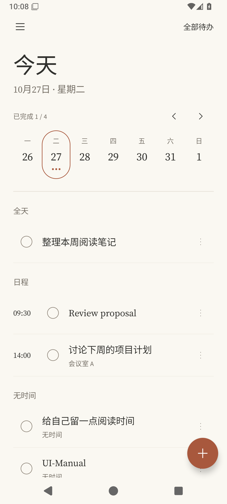
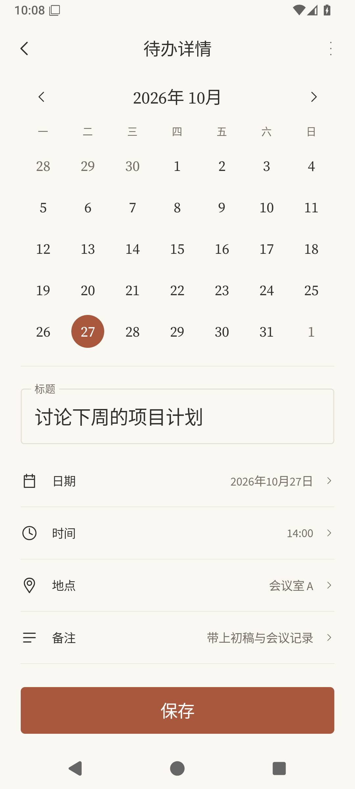

# 0.3.0 UI 对齐与验证

本轮以 [U03](../design/exploration-v1/U03.png) 的周历／日程和添加编辑布局、[I01](../design/exploration-v1/I01.png) 的细线图标为基准。以下截图来自应用在独立 Android API 36 模拟器上的实际渲染，使用合成待办；日期按模拟器本地时间显示，不是用户手机截图，也不是设计稿。

## 交付变化

- 首页：暖白纸色、炭黑文字、陶土色强调；左侧菜单、右侧全部待办；周历日期胶囊与事项圆点；全天／日程／无时间分组，定时事项左侧独立时间列；圆形完成控件、细分隔线、更多操作和圆形添加按钮。
- 添加／编辑：可切换月份与直接选日的内嵌月历；边框标题输入；日期、时间、地点、备注、提醒、重复的细线图标行；保存按钮固定在可视底部，键盘出现时仍可操作。提醒和重复可向下滚动查看；日期行保留完整日期选择器。
- 原有滑动完成／删除、撤销、完成动画、列表重排、详情过渡、普通及减少动态效果的添加浮层继续使用。复制、删除、推迟提醒统一收进详情右上角菜单。
- 动态取色默认关闭，使未主动选择动态配色的安装使用参考图暖色主题；已保存的明确选择继续保留。若更新后仍随壁纸取色，可在设置中关闭“动态取色”。

## 字体选择

用户已确认采用风格相近的开源组合：英文标题及清单 Source Serif 4，辅助标签 Source Sans 3，中文思源黑体 Source Han Sans SC。它们并非 Claude 原版字体，也不代表核实了 Claude 当前中文回退字体。字体随 APK 离线提供，英文与中文混排使用明确的回退顺序。

三个字体均为未经改动的上游 Regular 文件，随包保留 SIL OFL 1.1 许可证。[字体来源记录](../design/font-sources.json) 保存固定提交、下载地址和 SHA-256。完整中文字库会增加包体。API 29+ 使用 Android 公共自定义回退 API；Android 8/9 使用思源黑体自带拉丁字形，不显示同样的英文衬线标题，本轮未对这两个旧版本做运行验证。

## 验证边界

本轮仅使用工作区构建和独立模拟器。真实模型网络评测没有启用；模拟器结果不等于 OPPO 后台、重启、Doze 或其他品牌兼容性通过。用户已要求暂缓的重启提醒问题未作修改；实际帧率、启动耗时和内存指标仍待测量。

调试包沿用现有开发签名，可从 0.2.0 覆盖更新；Release 沿用已有独立发布签名。版本号 0.3.0 / versionCode 3，Room 数据库仍为 v1。

## 本轮结果

- JVM：52 项通过，1 项真实模型评测按设计跳过；新增月历测试覆盖闰年、跨年和 4–6 行月历。
- Lint：0 error（23 warning、1 hint，保留报告）；Debug、测试 APK、签名 R8 Release 和 profile／benchmark 构建完成。
- API 36 模拟器完整 instrumentation：29 项通过，1 项手动场景准备工具按设计跳过。涵盖数据库、提醒调度／通知操作、Keystore、假客户端 AI 导入、分享导入、增删改撤销、滑动手势、通知详情导航，以及本轮月历／字段弹窗。
- 360dp、130% 字号下追加 UI 测试 3/3 通过；正常宽度下最后的显示修正回归 3/3 通过。人工查看了真实截图，包括键盘出现后的标题和保存按钮、深色减少动态效果浮层。字段测试验证日期、地点、备注、17 分钟自定义提醒和每月重复确实落库。
- 本地主机证据：`.tools/downloads/ui-align-final-build.log`、`ui-final-contrast-build.log`；模拟器证据：`ui-align-emulator-final-suite.log`、`ui-align-narrow-font130.log`、`ui-final-render-tests.log`。测试日志保留在忽略版本控制的工作区目录。

本轮采用当前 Compose 库提供的 v2 测试规则，修正旧测试规则在带动画导航时的等待／生命周期问题；没有为通过测试关闭生产动效或更换生产导航依赖。profile 构建成功不代表已采集 baseline profile 或得到性能结果。

## 渲染截图

| 首页 | 编辑页 |
| --- | --- |
|  |  |

其他状态：[快速添加](ui-0.3.0/quick-add-light.png)、[键盘与保存](ui-0.3.0/editor-keyboard.png)、[深色首页](ui-0.3.0/home-dark.png)、[深色减少动态效果浮层](ui-0.3.0/quick-add-dark-reduced.png)。

窄屏与大字号：[首页](ui-0.3.0/narrow-font130-home-light.png)、[编辑页](ui-0.3.0/narrow-font130-editor-light.png)、[输入时](ui-0.3.0/narrow-font130-editor-keyboard.png)。日期网格维持至少 48dp 触控范围；内容较长时纵向滚动，进一步放大字号或缩窄屏幕时日历可横向滚动。截图中的 `UI-Manual` 也是本轮手动检查创建的合成待办。
