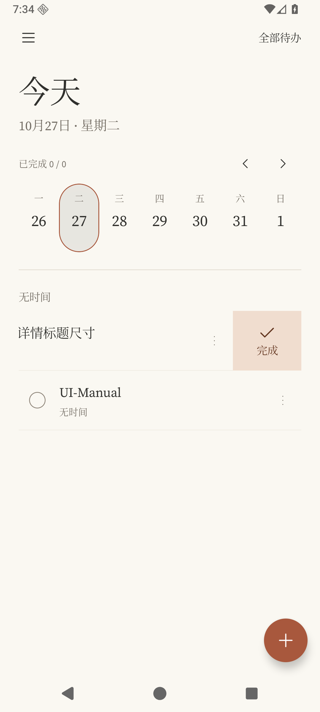
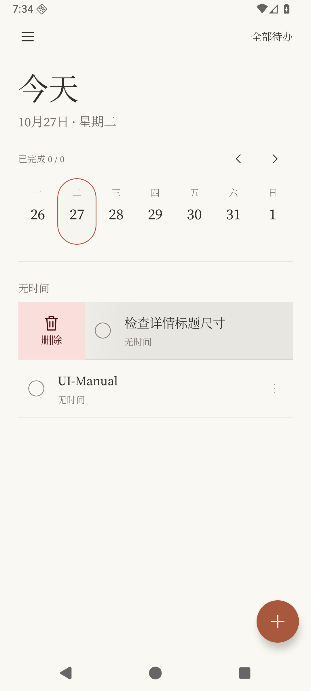

# 0.3.1 交互与字体修复

根据用户安装 0.3.0 后的反馈修复，版本 0.3.1 / code 4，沿用原签名和 Room v1。中文思源宋体是用户进一步确认的开源选择，未使用 Windows 中易宋体；英文仍为 Source Serif 4 / Source Sans 3。原始字库与 SIL OFL 1.1 许可证随包提供，来源与哈希见 [font-sources.json](../design/font-sources.json)。

| 反馈 | 修复后的行为 |
| --- | --- |
| 左／右滑直接完成或删除 | 左滑露出右侧完成／重新打开按钮，右滑露出左侧删除按钮；松手不修改待办，点击按钮才执行。点条目正文可收起菜单，执行后仍可撤销。 |
| 详情进入／返回时标题突然变大 | 容器转场改为按边界重新布局，去掉列表文字与整个标题输入框之间的嵌套共享缩放。保留容器移动、淡入淡出和返回过渡。 |
| 周历日期出现矩形点击效果 | 点击效果按日期胶囊的相同圆角轮廓裁剪。 |
| 中文改宋体 | 全局中文改为思源宋体，离线内置；移除原思源黑体。Android 8/9 使用宋体字库自带拉丁字形作兼容回退，旧版本运行验证仍待补充。 |
| 移除详情“日期”栏 | 添加／详情表单移除独立日期行；上方月历选日，点年月标题可快速选择远期日期，日历区域保留清除日期。 |
| 保存或取消添加时退出不顺 | 协调键盘收起与浮层退出，等待退出动画完成后再移除页面；退出期间不将整张表单突然变灰，主页列表在浮层关闭后再显示新增条目。普通与减少动态效果模式均覆盖。 |

## 验证

- 52 项 JVM 测试通过；1 项需真实模型网络的评测按设计跳过。
- API 36 独立模拟器完整 instrumentation：32 项通过，1 项需手动启用的场景准备工具按设计跳过。
- 增补的交互验证 3/3 通过：空白添加直接返回、输入后取消、键盘“完成”保存，在普通／减少动态效果两种模式下均执行；日期仅经日历选择与清除；菜单及详情过渡截图采样。
- 360dp、130% 字号的布局与编辑回归 3/3 通过；最后的按下态／转场采样 1/1 通过，检查了胶囊内的灰色点击效果。
- Debug、测试包、签名 R8 Release、profile／benchmark 构建通过；Lint 零错误（23 warning、1 hint）。最后修改的截图测试另行编译并做 Lint 检查。
- 本地证据保留于 `.tools/downloads/ui031-full-build.log`、`ui031-final-suite.log`、`ui031-expanded-interaction.log`、`ui031-narrow-font130.log`、`ui031-pressed-transition-final.log` 和 `ui031-final-test-lint.log`。首轮截图采样因暂停时钟前未等待菜单收起而超时，测试修正等待顺序后通过；未据此修改生产逻辑或关闭动效。

截图是合成数据在模拟器中的真实画面，日期按模拟器时区显示。过渡采样用于检查文字尺度，不等于真机帧率测量；用户手机上的退出手感及预测性返回仍需复测。此次未操作用户手机，也未修改此前暂缓的 OPPO 重启提醒问题。

## 预览

| 左滑后等待点击 | 右滑后等待点击 |
| --- | --- |
|  |  |

[宋体首页](ui-0.3.1/home-light.png) · [详情与日历](ui-0.3.1/editor-light.png) · [快速添加](ui-0.3.1/quick-add-light.png) · [键盘与保存](ui-0.3.1/editor-keyboard.png) · [大字号编辑页](ui-0.3.1/narrow-font130-editor.png) · [胶囊点击效果](ui-0.3.1/week-pressed.png)

过渡采样：[进入](ui-0.3.1/detail-enter-180ms.png)、[返回](ui-0.3.1/detail-return-80ms.png)。文件名毫秒数指测试时钟采样点，不代表设备实际渲染延迟。
